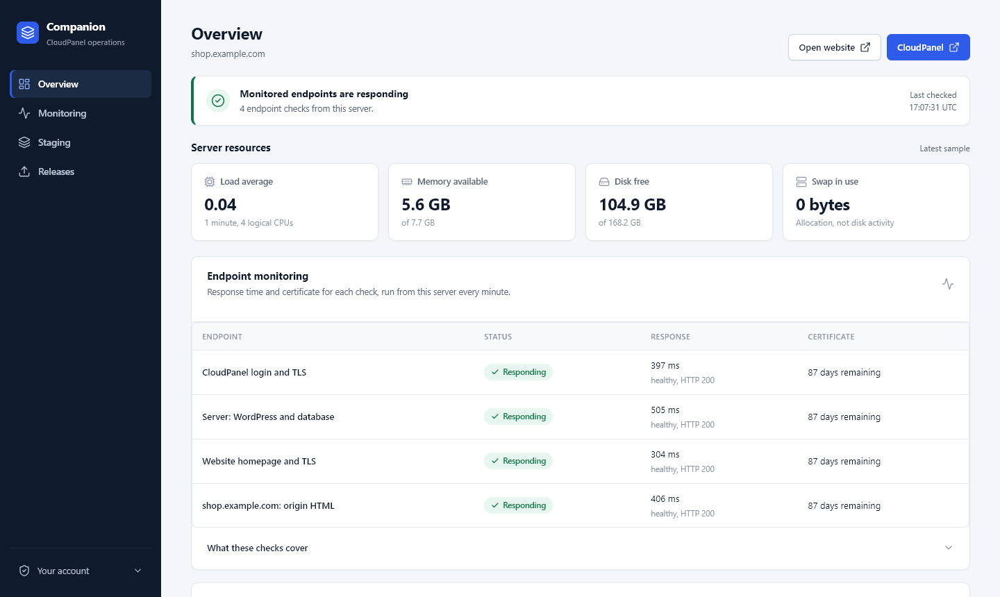

## CloudPanel Companion

A small control panel that runs next to [CloudPanel](https://www.cloudpanel.io/) on your server and adds the things CloudPanel doesn't have for a WordPress / WooCommerce site:

- **Monitoring**: server and website health with 7 days of history, Slack alerts, automatic restart of a failed service, and an alert when a scheduled backup doesn't succeed.
- **Staging**: a password-protected copy of your site that you refresh with one click. Emails, payments and webhooks are blocked on it.
- **Releases**: pick the theme and plugin files you changed on staging and copy them to the live site, with a check before and a recovery copy after.
- **Page cache**: a Varnish page cache that clears itself when you edit content (uses the [Cache Manager for CloudPanel](https://github.com/bomsn/cache-manager-for-cloudpanel) WordPress plugin).

It runs on its own address (for example `ops.example.com`) with its own logins and two-factor sign-in. It does not change CloudPanel itself, and your site keeps working if the Companion is stopped.



## Requirements

- A server running **Ubuntu 24.04** with **CloudPanel** installed, and root (sudo) access over SSH. On a fresh server, `sudo bash prepare-server.sh --admin-user NAME --authorized-keys FILE --ssh-port PORT` installs CloudPanel and prepares the server (see the top of that script for what it does and the two-step SSH port change).
- Your WordPress site already added in CloudPanel.
- DNS records pointing at the server for:
  - your website, for example `shop.example.com`
  - CloudPanel, for example `panel.example.com` (add it in CloudPanel under Settings > Custom Domain)
  - the Companion, for example `ops.example.com`
  - staging, if you want it, for example `stg.example.com`
- Optional: a Slack incoming webhook for alerts.

One Companion manages one website per server. It has been tested with CloudPanel 2.5 and PHP 8.3.

## Getting started

Connect to the server and download the Companion (and the cache plugin, if you want the page cache):

```shell
ssh root@your.server.ip
apt-get -y install git
git clone https://github.com/bomsn/cloudpanel-companion.git
git clone https://github.com/bomsn/cache-manager-for-cloudpanel.git
cd cloudpanel-companion
```

Run the installer:

```shell
sudo bash install.sh
```

It asks a few questions (your site's address and CloudPanel user, the addresses above, and which optional parts you want), then installs everything in the right order and shows its progress.

**Some steps happen in CloudPanel's website** (two, plus one for staging after the optional safeguards). CloudPanel only lets you change a site's vhost in its own editor. When the installer reaches one of these steps it saves the exact text to `/root/companion-setup/`, tells you which site to open and what to paste, and carries on with the rest; at the end it lists those steps again. Paste each text into the site's Vhost tab and click Save; `sudo bash install.sh status` then shows them as done. Running the installer again is always safe: it skips finished steps and carries on from where it stopped.

**Moving a site from another host?** Until its DNS points to this server, CloudPanel can't issue the website's own certificate, so four steps that check the website over HTTPS (code releases, page cache, monitoring and the website routing) wait, and setup says so; everything else, staging included, is set up. After the DNS switch, issue the certificate the CloudPanel way (`clpctl lets-encrypt:install:certificate --domainName=shop.example.com`, which CloudPanel then renews) and run `sudo bash install.sh` again to finish them.

**Behind Cloudflare with an Origin CA certificate?** Answer yes when setup asks about it (on an existing install, run `sudo bash install.sh --reconfigure`) and import the certificate in CloudPanel (the site's SSL/TLS tab, Actions > Import Certificate). The Companion's checks then trust Cloudflare's Origin CA for your website and still verify its certificate. Until it's imported, the same four steps wait; run `sudo bash install.sh` again right after importing it.

When it finishes, open `https://ops.example.com`, sign in with the operator account you created during setup, and scan the QR code with an authenticator app.

## Using it

| Page | What you can do |
|------|-----------------|
| **Overview** | See at a glance whether the website, database, certificates, services and scheduled backups are healthy. |
| **Monitoring** | CPU, memory, response times, cache hit rate, PHP workers, errors and service changes for the last hour, 24 hours or 7 days. |
| **Staging** | Open staging, pause it, change its password, or refresh it with a new copy of the live site. Turn on approved test email or webhooks under **External tests**; captured test emails appear in **Test inbox**. |
| **Releases** | Click **Check changes** to compare staging with the live site, select the folders or files to move, review, and release. |

Changes that affect the live site or staging ask you to confirm your password again first.

Each staging refresh keeps the previous copy so you can roll back. Old copies are never deleted automatically; when disk space matters, run `sudo bash install.sh cleanup-staging`. It always keeps the current copy and the two latest of each kind.

### Useful commands

```shell
sudo bash install.sh status                 # what is installed and what is left
sudo bash install.sh add-operator NAME      # create another login
sudo bash install.sh --reconfigure          # answer the setup questions again
sudo bash install.sh cleanup-staging        # list old staging copies and remove them after you confirm
```

In WordPress, the page cache has its own screen under **Tools > CloudPanel cache**, and `wp cloudpanel-cache purge` clears it from the command line.

## Updating

```shell
cd cloudpanel-companion && git pull
sudo bash install.sh
```

The installer updates the Companion, including the system services of the parts you installed, without stopping your website. To update the cache plugin, pull its repository and run:

```shell
sudo python3 install-cache.py --host shop.example.com --user shop --php 8.3 --plugin-source ../cache-manager-for-cloudpanel --upgrade
```

That briefly shows a maintenance page, swaps the plugin, checks the site and puts the old version back automatically if anything fails.

## Before you rely on it

- **Off-server backups** are not part of the Companion. Use [Rclone Automated Backups](https://github.com/bomsn/rclone-automated-backups) and test a restore. The Companion then lists its scheduled backups on the Overview and alerts you (Slack, if set up) when one hasn't succeeded within three hours of its scheduled time.
- **An external uptime monitor** is still needed. The Companion runs on the same server, so it can't tell you if the whole server is down.
- **Extra safeguards** (separating site users, PHP worker limits, OPcache tuning) are optional: see [docs/security-safeguards.md](docs/security-safeguards.md).

## More detail

How each part works, its limits and the safety rules behind it: [docs/how-it-works.md](docs/how-it-works.md).

Tests run on Linux: `python3 -m unittest discover -s tests`.
