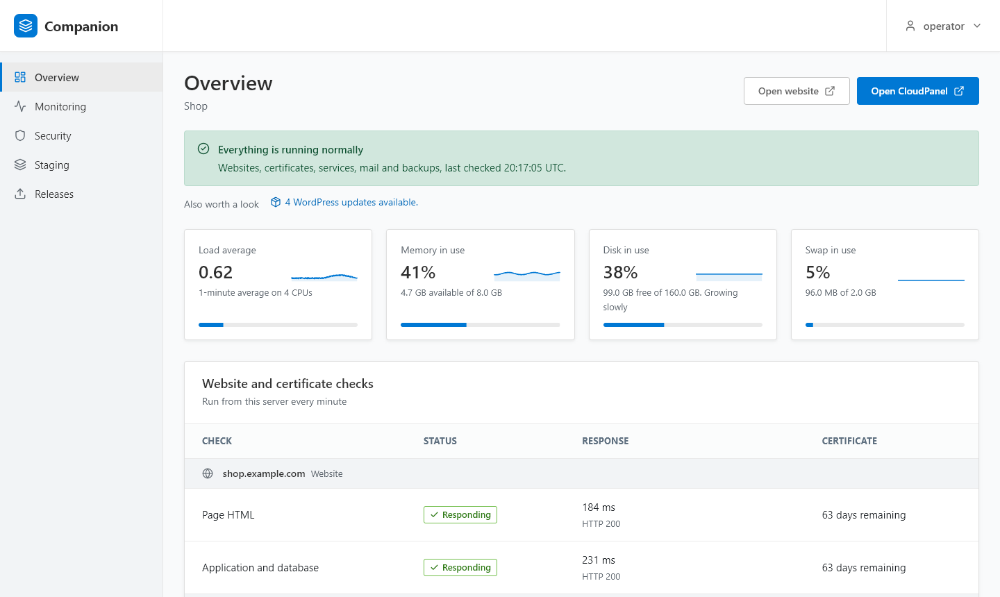

# CloudPanel Companion

CloudPanel Companion is a small control panel that runs next to [CloudPanel](https://www.cloudpanel.io/) on the same server. It adds what CloudPanel doesn't have for a WordPress or WooCommerce site: monitoring with alerts, a sign-in history, a safe staging copy and reviewed code releases.



## What it does

- **Overview**: one page that tells you whether everything is fine, and links straight to anything that isn't.
- **Monitoring**: CPU, memory, response times, cache use and errors for the last hour, day or week. It also watches services, scheduled jobs, the mail queue, disk growth, WordPress updates and your scheduled backups.
- **Security**: who signed in to the Companion, CloudPanel and SSH, from which IP address and country, failed attempts and current SSH bans. A Website tab shows the bots that went looking for secret files, the addresses that were banned and other missing pages, with ready-to-copy suggestions for a Cloudflare rule.
- **Blocked scans**: bots looking for secret files, configuration and backups (such as `/.env` or `/backup.sql`) get a quick "not found" without starting WordPress, and an address that keeps trying is banned for a day.
- **Staging**: a password-protected copy of your site that you refresh with one click. Emails, payments and webhooks are blocked on it unless you approve a test.
- **Releases**: pick the theme and plugin files you changed on staging, review them and copy them to the live site, with a recovery copy kept.
- **Alerts**: optional Slack messages for anything that needs you, such as a failed service, a stuck mail queue, a missed backup, every sign-in to CloudPanel or the Companion (SSH once a day per user and address), or a burst of failed sign-ins. Each message starts with the server's name and address and the website it is about.
- **Page cache and object cache** (optional): Varnish with the [Cache Manager for CloudPanel](https://github.com/bomsn/cache-manager-for-cloudpanel) plugin, which clears pages when you edit content, and a private Redis object cache.

The Companion has its own address (for example `ops.example.com`), its own logins and optional two-factor sign-in. It doesn't modify CloudPanel's application, and your site keeps working if the Companion stops.

## Requirements

- Ubuntu 24.04 with CloudPanel installed, and root (sudo) access over SSH.
- Your WordPress site added in CloudPanel. One Companion looks after one website.
- DNS records pointing at the server for:
  - the website, for example `shop.example.com`
  - CloudPanel, for example `panel.example.com` (set it in CloudPanel under Settings > Custom Domain)
  - the Companion, for example `ops.example.com`
  - staging, if you want it, for example `stg.example.com`
- Optional: a Slack incoming webhook for alerts.

It is tested with CloudPanel 2.5 and PHP 8.3.

Starting from a fresh server? `prepare-server.sh` installs CloudPanel and sets up a sudo user, SSH keys and a new SSH port. Run `sudo bash prepare-server.sh --help` to see its options.

## Install

Download the Companion, and the cache plugin if you want the page cache:

```shell
apt-get -y install git
git clone https://github.com/bomsn/cloudpanel-companion.git
git clone https://github.com/bomsn/cache-manager-for-cloudpanel.git
cd cloudpanel-companion
sudo bash install.sh
```

The installer asks a few questions: your site's address, CloudPanel site user and PHP version, the Companion and CloudPanel addresses, and which optional parts you want. It saves the answers and installs everything in order. Running it again is always safe: it skips finished steps and continues where it stopped.

**A few steps happen in CloudPanel.** CloudPanel only lets you change a site's vhost in its own editor. When the installer reaches one of those steps, it saves the exact text to `/root/companion-setup/`, tells you which site to open and carries on. Paste each text into that site's Vhost tab and click Save. `sudo bash install.sh status` then shows the step as done.

**Moving a site from another host?** Until the website's DNS points to this server, CloudPanel can't issue its certificate, so the steps that check the website over HTTPS wait. Everything else, staging included, is set up. After the DNS switch, issue the certificate with `clpctl lets-encrypt:install:certificate --domainName=shop.example.com` and run `sudo bash install.sh` again.

**Behind Cloudflare with an Origin CA certificate?** Answer yes when the installer asks, and import the certificate in CloudPanel (the site's SSL/TLS tab, Actions > Import Certificate). Then run `sudo bash install.sh` again.

When it finishes, open `https://ops.example.com` and sign in with the operator account you created.

## Update

Each release is a single commit, so update with a fetch and reset rather than `git pull`, then run the installer:

```shell
cd cloudpanel-companion
git fetch origin && git reset --hard origin/master
sudo bash install.sh
```

The installer updates everything you installed, adds any part that is new in the release and keeps your website running.

To update the cache plugin, update its folder the same way, then run this from the Companion folder:

```shell
sudo python3 install-cache.py --host shop.example.com --user shop --php 8.3 --plugin-source ../cache-manager-for-cloudpanel --upgrade
```

It shows a maintenance page for a moment, swaps the plugin, checks the site and puts the old version back if anything fails.

## Using it

| Page | What you'll find |
|------|------------------|
| **Overview** | Whether anything needs attention, server load, memory, disk and swap with their last 24 hours, website and certificate checks, services and scheduled backups. |
| **Monitoring** | Charts for the last hour, 24 hours or 7 days, response times by page type, recurring errors, PHP and database counters (including how much OPcache memory is wasted and what the nightly OPcache check did), disk growth, the mail queue, WordPress updates and every watched service. |
| **Security** | One card each for the Companion, CloudPanel, SSH and the website. Pick one to see its last 7 days, sign-ins, failed attempts by source and, for the two panels, visits. The website card shows blocked scans, banned addresses and other missing pages. |
| **Staging** | Open, pause or refresh staging and change its password. Approve test emails, requests or webhooks under **External tests**; captured emails appear in **Test inbox**. |
| **Releases** | Click **Check changes**, select the folders or files to move, review them and apply. Restore the previous code from **Release history** if you need to. |
| **Account** | Turn two-factor sign-in on or off, change your password and sign out other sessions. You'll find it in the account menu at the top right. |

Changes that affect the live site or staging ask you to confirm it's you first, with your password or an authenticator code. That confirmation lasts five minutes.

Useful commands:

```shell
sudo bash install.sh status            # what is installed and what is left to do
sudo bash install.sh add-operator NAME # create another login
sudo bash install.sh --reconfigure     # answer the setup questions again
sudo bash install.sh cleanup-staging   # remove old staging copies, after you confirm
```

Each staging refresh keeps the previous copy so you can roll back, and old copies are never deleted on their own. `cleanup-staging` always keeps the current copy and the two latest of each kind.

## What it changes on your server

- Installs its code in `/opt/cloudpanel-companion` and its Python environment in `/opt/cloudpanel-companion-venv`.
- Adds its own system services and timers, named `companion-*` (plus `cache-manager-control` with the page cache), and keeps settings in `/etc/cloudpanel-companion` and data in `/var/lib/cloudpanel-companion-*`.
- Creates a CloudPanel reverse-proxy site for the Companion's address, and adds Nginx files named `000-companion-*.conf`.
- Writes `/etc/cloudpanel-companion/client-address-public.conf` and `client-address-backend.conf`, which your website's and staging's vhosts include. With them, WordPress sees each visitor's real address: only Cloudflare can pass one on, and no visitor can set their own with a header. After updating from an earlier version, `sudo bash install.sh` asks you to paste the website's and staging's vhost text again.
- Adds one `include` line to CloudPanel's custom-domain vhost, so failed CloudPanel sign-ins and visits are logged privately for the Security page. If CloudPanel rewrites that vhost, the Security page says so and `sudo bash install.sh` adds the line back.
- Writes the website's and staging's security file, `/etc/cloudpanel-companion/sites/USER-security.conf`, which both of their vhosts include. Besides the earlier safeguards (no PHP in uploads, no backup folders, no links to other users' files), it answers scans for secret files, configuration and backups with a 404 before WordPress, keeps WooCommerce's private downloads private, and turns away banned addresses with a 403. The rules themselves are in `/etc/nginx/sites-enabled/000-companion-probes.conf`. Each scan is written to a private log, `/var/log/cloudpanel-companion/probes.log`, rotated daily and kept for a week. Sites that already include this file need no new vhost paste.
- Adds a Fail2ban jail, `companion-probes`, that reads only that log: 3 scans within an hour ban the address for 24 hours, and each new ban of a repeat offender lasts twice as long, up to a week. Bans are enforced in Nginx, because visitors arrive through Cloudflare and a firewall ban would block nothing. Loopback, the server's own addresses, Cloudflare and the addresses you list during setup are never banned. Nothing inside WordPress's own folders (`wp-content`, `wp-includes`, `wp-admin`, `wp-json`) is ever counted, nor is a missing archive at the web root (a customer could follow a dead download link), nor are requests that identify as a search engine, a link preview or an uptime monitor. A ban covers the website and staging only, never the Companion or CloudPanel. `sudo fail2ban-client status companion-probes` lists the bans and `sudo fail2ban-client set companion-probes unbanip ADDRESS` lifts one. Fail2ban keeps 30 days of ban history instead of one day, so it can recognise repeat offenders. The Companion never talks to Cloudflare.
- Makes Fail2ban's SSH jail ban on the port SSH really uses. Ubuntu's jail bans on port 22 only, so with SSH on another port a banned address could keep trying. If Fail2ban's settings miss an SSH port, it writes `/etc/fail2ban/jail.d/companion-sshd.conf` with every port SSH listens on, tests it and restarts only the SSH jail, which keeps its current bans. It never changes SSH itself, or a Fail2ban file it did not write.
- Owns the website's OPcache settings in `99-companion-performance.ini` (768 MB, a 64 MB string buffer, 100,000 script slots) and adds a nightly OPcache check, `companion-opcache-upkeep`, that reloads PHP-FPM gracefully only when OPcache wastes 10% or more of its memory or is full, and never while a staging refresh or a release runs. A reload lets running requests finish for up to 10 seconds, CloudPanel's own setting. It runs at 04:30 server time unless you chose another time during setup.
- With Slack, saves the server's name, public address and the website in `/etc/cloudpanel-companion/alert-context.json` (no secret in it), so every alert says where it comes from. Setup detects them; `sudo bash install.sh --reconfigure` lets you change them.
- For staging, creates a separate Unix user, site and database, plus network rules that stop staging from reaching the outside world.

The full list, with the safety rules behind each part, is in [docs/how-it-works.md](docs/how-it-works.md).

## Limits

- It can't tell you when the whole server is down, because it runs on that server. Use an external uptime monitor as well.
- Off-server backups aren't included. Use [Rclone Automated Backups](https://github.com/bomsn/rclone-automated-backups) and test a restore; the Companion then shows its schedules and alerts you when one is missed.
- Releases copy theme and plugin code only. The database, uploads and settings are never copied, so plugin updates that change the database need their own plan.
- It looks after one WordPress site per server.
- Scan blocking stops known kinds of junk requests on this server; it is not a web application firewall. Keep using Cloudflare for that, and use the Website tab's suggestions to improve your Cloudflare rules by hand.
- Optional server safeguards, such as separating site users and PHP worker limits, are a separate tool: see [docs/security-safeguards.md](docs/security-safeguards.md).

## Uninstall

There is no one-click uninstaller, because the page cache, Redis and staging rules may still be serving your site. Stopping the Companion's interface and operations service doesn't affect WordPress. To remove it completely, follow [Disabling or retiring an installation](docs/how-it-works.md#disabling-or-retiring-an-installation).

## Tests

On Linux, run `python3 -m unittest discover -s tests`. The web tests run inside the Companion's Python environment with `python tests/run_web_checks.py`.

## Licence

MIT. See [LICENSE.txt](LICENSE.txt).
